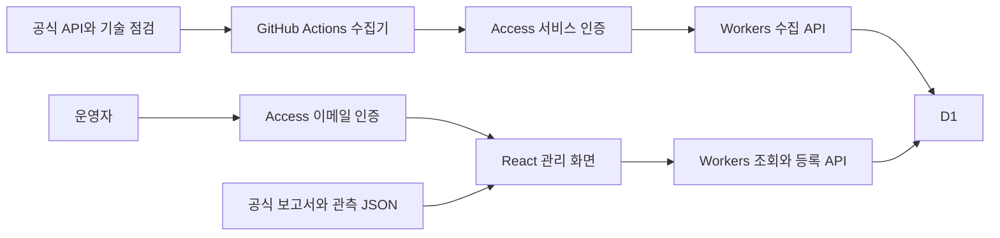

# AEO GEO 운영 대시보드 상세 개발계획

작성일: 2026-10-16 KST. 상태: 개발 착수용 계획. 대상: TOP 건강백과와 영통탑내과의 검색·AI 노출을 관리하는 운영자 앱. 이 문서는 저장소 내부 개발 자료이며 환자용 사이트에 게시하지 않는다.

**React·Vite 관리 화면, Cloudflare Workers API, D1 저장소, Access 인증, GitHub Actions 수집기로 구현한다.** 운영자 1~5명과 하루 한 번 수집을 초기 규모로 삼고, 추가 인프라 비용 월 $0을 목표로 한다. 유료 AI 호출은 기본 비활성화한다. 계정 연결이나 관측 자료가 없는 지표는 미연결·미측정으로 표시한다.

현재 요청의 결과물은 개발계획이다. 계정 생성, 서비스 가입, 코드 구현, 예약 작업 등록, 원격 배포는 후속 구현 작업에 해당한다. 아래의 합격 기준과 예상 일정은 실제 완료 기록이 아니다.

## 문서 구성

| 문서 | 결정할 내용 |
|---|---|
| [이 개발계획](README.ko.md) | 목적, 범위, 구성, 화면, 단계와 착수 조건 |
| [데이터와 지표 계약](data-contracts.ko.md) | 출처별 수집, 계산식, 저장 모델, API와 가져오기 규칙 |
| [개발 작업과 검증](implementation-backlog.ko.md) | 작업 순서, 산출물, 의존성, 합격 기준, 예상 공수 |
| [배포와 운영 절차](operations.ko.md) | 계정·인증·비밀 설정, 무료 한도, 수집 일정, 복구와 출시 점검 |

## 목표와 완료 범위

운영자가 어느 페이지가 검색·AI에 노출되는지, 관측된 답변이 정확한지, 데이터가 언제 갱신됐는지 확인하고 근거까지 열람할 수 있게 한다. 실제 성과와 기술적 준비 상태를 각각 표시해 다음 콘텐츠 개선 대상을 정할 수 있게 한다.

| 단계 | 포함 | 완료 판단 |
|---|---|---|
| 1차 제품 | 인증된 화면, D1, 기술 점검 수집, AI 관측 JSON 등록, Google AI 공식 보고서 가져오기, 추세·출처·수집 상태, 백업·복구 | 실제 기술 점검과 가져온 자료를 원본과 대조하고 전체 출시 기준 통과 |
| 1차 연결 확장 | Search Console 일반 검색 API, URL Inspection 표본, 확인된 Bing 공식 내보내기 형식 | 계정 권한과 실제 응답·파일을 확보한 연결만 운영 활성화 |
| 2차 제품 | GA4 집계 연결, 방문 행동 이벤트, 검색 API를 이용한 제한된 AI 실험 | 이벤트 정의·계정 연결·별도 실행 예산을 갖춘 기능부터 추가 |
| 이후 검토 | 사용자 도메인, 자동 알림, 큰 증거 파일 저장소, 더 긴 보관 기간 | 실제 운영 요구와 비용을 확인한 뒤 추가 |

Google AI 보고서가 계정에 아직 나타나지 않아도 기술 점검·자체 관측 기능의 출시를 막지 않는다. 해당 카드에는 수집 경로와 현재 상태를 표시한다. 반면 인증, 데이터 비공개, 지표 분모 검증, 복구 검증은 1차 출시 필수 조건이다.

임의의 AEO/GEO 종합 점수, 실제보다 넓은 AI 시장 점유율, 순위·인용 상승 보장, 모델 학습 여부 추정은 제공하지 않는다. 병원 예약 처리·진료기록·환자 식별정보 수집은 이 앱의 범위에 없다.

## 현재 저장소와 재사용 범위

2026-10-16 로컬 저장소 확인 기준이다. 과거 인수 문서의 45개 경로·32개 질문 수치 대신 현재 원장을 따른다.

| 현재 자산 | 현황 | 개발 시 조치 |
|---|---|---|
| [환자용 콘텐츠 기준](../patient-content-policy.ko.md) | 운영 보고서를 공개 사이트와 분리 | 관리 앱을 별도 빌드·호스팅하고 `web/out/`에 넣지 않음 |
| [사이트 설정](../../content/site.json) | 사이트 이름 TOP 건강백과, 운영 병원 영통탑내과 | 사이트명 언급과 병원명 언급을 서로 다른 지표로 정의 |
| [페이지 원장](../../content/pages.json) | 135개 경로 | 점검 시 현재 배포 매니페스트의 경로·색인 대상을 읽음 |
| [2026-10-15 릴리스 기록](../seo-release-2026-10-15/README.ko.md) | 당시 검색 허용 대상 132개 | 이 수를 상수로 고정하지 않고 각 측정의 분모·배포 SHA 보존 |
| [단일 질문](../../content/measurement-queries.json) | 73개, `2026-09-28-v4` | 20개 핵심 질문을 별도 버전으로 선정하고 73개 전체 평가도 유지 |
| [다중 대화](../../content/measurement-conversations.json) | 13개, `2026-09-25-v1` | 원래 대화 순서·선행 발화·언어를 유지 |
| 두 관측 설정의 `site` | 과거 GitHub Pages 주소 | 신규 설정 버전을 만들어 `https://yttop.kr/` 적용; 과거 기록은 당시 설정 보존 |
| [관측 집계 함수](../../web/scripts/measurement.mjs) | 신규·기존 사이트 인용, 언급, 정확도, 실패 분리 | 순수 함수를 어댑터로 재사용하고 현재 테스트 유지 |
| [대화 집계 함수](../../web/scripts/conversation-measurement.mjs) | 첫 답변·후속 답변·연속 인용 구분 | 누락 턴·유도된 병원명 언급을 계속 구분 |
| [기존 배포](../../.github/workflows/pages.yml) | Next.js 정적 출력 검증 후 GitHub Pages 배포 | 관리 앱의 배포 작업과 분리; 기존 release gate와 실배포 검증 유지 |

현재 관측 스크립트는 입력 JSON을 집계하며 외부 AI 답변을 자동 수집하지 않는다. 단일 질문 집계의 일부 조건은 선택 필드이므로 새 입력 계약에서 버전·질문 원문·출처를 더 엄격하게 검증한다. 기존 테스트 통과를 신규 수집기의 검증 완료로 대신하지 않는다.

## 시스템 구성



관리 앱의 최초 주소는 `https://<worker>.<account>.workers.dev/aeo-geo/`다. 꺾쇠 안의 값은 배포 때 정할 자리표시자다. 화면과 API를 같은 origin에 두어 별도 CORS 설정을 줄인다. 나중에 `ops.yttop.kr/aeo-geo/`로 연결할 수 있다. `yttop.kr/admin/...`은 경로별 프록시·DNS 운영 검토가 추가되는 선택 사항이다.

Cloudflare는 Workers와 정적 자산을 함께 배포하는 [React·Vite 구성](https://developers.cloudflare.com/workers/framework-guides/web-apps/react/)과 [Access 보호](https://developers.cloudflare.com/workers/configuration/cloudflare-access/)를 제공한다. 최초 주소와 배포 미리보기 주소 모두 보호하거나 사용하지 않는 경로를 비활성화한다.

관리 앱은 CSR로 구현하고 공개 검색용 SSR을 추가하지 않는다. Worker는 인증·작은 입력 검증·인덱스를 이용한 조회·작은 배치 저장을 맡는다. 외부 API 호출, CSV 정규화, 기술 점검, 대량 집계는 Node.js 수집기에서 수행한다. 브라우저 파일 가져오기는 작은 청크로 전달하며 서버에서도 다시 검증한다.

기본 앱 소스는 이 저장소의 `admin/`에 둔다. 계정 설정·실제 운영 데이터는 소스와 분리한다. 저장소 공개 여부와 무관하게 원본 답변, OAuth 토큰, SQL 백업을 커밋하거나 공개 Actions artifact에 올리지 않는다. 별도 비공개 실행 저장소가 필요해지면 수집기 코드를 중복 작성하지 않고 검증된 소스 SHA를 고정해 실행한다.

## 파일 구조와 배포 경계

아래 경로는 구현할 위치이며 아직 생성된 앱 파일을 의미하지 않는다.

```text
admin/
  package.json                  # 독립 설치와 잠금 파일
  package-lock.json
  wrangler.jsonc                # staging / production 자원 구분
  src/client/                   # React 화면과 파일 가져오기
  src/worker/                   # Hono API와 인증·권한 검사
  src/contracts/                # 입력·응답 스키마, 지표 버전
  src/measurement/              # 기존 순수 집계 코드의 어댑터
  collectors/                   # Node.js 24 수집·정규화·재시도
  migrations/                   # D1 SQL 변경 이력
  tests/                        # 합성 fixture와 계약·통합·브라우저 검사
  .env.example                  # 이름과 설명만 보관
.github/workflows/
  admin-check.yml               # PR 검증, 운영 비밀 설정 없음
  admin-deploy.yml              # 관리자 앱만 배포
  admin-collect.yml             # 일별 수집과 수동 재실행
```

`admin/`의 빌드 산출물·Wrangler 상태·수집 임시 파일을 `.gitignore`에 추가한다. 환자용 원장 `content/pages.json`과 `content/page-intents.json`에는 관리 경로를 등록하지 않는다. 관리 앱은 환자용 검색, sitemap, llms 파일, 관련 안내 목록에도 포함하지 않는다. 기존 루트 패키지 구조를 바꾸는 대규모 모노레포 전환은 초기 작업에 포함하지 않는다.

## 화면과 사용 흐름

| 경로 | 제공 내용 | 필수 상태 |
|---|---|---|
| `/aeo-geo/` | 공식 노출, 관측 인용, 기술 점검, 데이터 갱신 상태를 구분한 요약 | 빈 상태, 미연결, 오래된 데이터, 부분 수집 |
| `/aeo-geo/pages/` | 원본 URL별 추세·최근 출처·문제 페이지 | 신규·기존·과거 배포 주소 구분 |
| `/aeo-geo/observations/` | 질문·서비스·버전별 언급·인용과 분모 | 브랜드 유도 여부, 실패와 미검토 수 |
| `/aeo-geo/observations/:id/` | 답변 원문·인용 URL·판정·정확성 검토 이력 | 앱/API 관측 구분, 실제 검토자 |
| `/aeo-geo/imports/` | 파일 선택 → 출처·기간 확인 → 검증 결과 → 확정 | 중복, 필수 열 누락, 잘못된 속성, 모호한 0 |
| `/aeo-geo/collections/` | 연결별 마지막 시도·성공·오류·재수집 범위 | 계정 연결 없음, 권한 만료, 할당량 초과 |
| `/aeo-geo/settings/` | 대상 속성·질문 버전·보관 정책·사용량 | 비밀값은 표시·반환하지 않음 |

기간은 7·28·90일을 기본 제공한다. 서비스, 출처, 새 사이트/원 사이트, 질문 묶음, 모델, 관측 방식, 언어·지역으로 필터링한다. 서로 다른 집계 단위의 숫자는 한 차트의 누적 합계로 합치지 않는다. 정확한 지표 계약은 [별도 문서](data-contracts.ko.md)를 따른다.

카드에는 값과 함께 출처, 대상 기간, 마지막 수집 시각, 표본 수 또는 범위, 잠정 여부를 표시한다. 원본 증거는 권한 있는 사용자만 열람한다. 증거의 URL을 환자용 사이트에 공개하지 않는다. 색상만으로 정상·실패를 구분하지 않고 키보드 탐색과 모바일 열람을 지원한다.

## 무료 운영 기본값

아래 한도는 2026-10-16 확인한 공식 요금·제한이며 실제 계정의 다른 프로젝트와 공유되는 사용량도 확인한다. 자체 운영 경고값은 공급자의 보장이나 무료 한도가 아니다.

| 자원 | 공급자 무료 범위 | 프로젝트 기본값 |
|---|---|---|
| Workers | 하루 10만 요청, HTTP·Cron 호출당 CPU 10ms | 조회 API p95 CPU 8ms 이하 목표, 요청 본문 64KiB 이하 |
| D1 | DB당 500MB, 계정 총 5GB, 하루 읽기 500만 행·쓰기 10만 행 | production 1개 + staging 1개, 300MB 경고·400MB 신규 대용량 등록 중지 |
| Access | 사용자 최대 50명 | 초기 허용 계정 1~5개 |
| GitHub Actions | Free 비공개 저장소 표준 실행 월 2,000분; 공개 저장소 표준 runner 무료 | Linux, 하루 1회, 작업당 10분 timeout, 유료 추가 사용 차단 설정 확인 |
| 정적 자산 | 직접 제공되는 정적 파일 요청 무료 | 사용자별 데이터는 번들에 넣지 않음 |
| 외부 AI | 서비스별 별도 조건 | 호출 예산 $0, 자동 실험 비활성화 |

출처: [Workers 요금](https://developers.cloudflare.com/workers/platform/pricing/), [실행 제한](https://developers.cloudflare.com/workers/platform/limits/), [D1 요금](https://developers.cloudflare.com/d1/platform/pricing/), [D1 제한](https://developers.cloudflare.com/d1/platform/limits/), [Access 요금](https://www.cloudflare.com/plans/zero-trust-services/), [GitHub Actions 과금](https://docs.github.com/en/billing/concepts/product-billing/github-actions), [정적 자산 요금](https://developers.cloudflare.com/workers/static-assets/billing-and-limitations/).

무료 한도 도달 시 일부 요청이 실패하거나 수집이 중단될 수 있다. 자동 유료 전환은 하지 않는다. 먼저 배치 크기·조회 범위·보관량을 줄이고 [운영 절차](operations.ko.md)에 따라 원인을 확인한다. 도메인 유지비·개발 인건비·수동 관측 시간은 인프라 $0에 포함되지 않는다.

## 진행 단계와 착수 조건

| 순서 | 산출물 | 다음 단계로 넘어갈 조건 |
|---|---|---|
| A 기반 확인 | 현재 배포·질문 버전 고정, 무료 계정·접근권한 점검 | 대상·계산 기준과 외부 연결 목록 확정 |
| B 실행 검증 | staging Worker, Access, D1 최소 API | 인증 우회 차단, 실제 CPU 한도 안에서 읽기·쓰기 |
| C 데이터 기반 | DB·API·입력 계약·기존 집계 어댑터 | 중복·실패·결측·버전 계약 검사 통과 |
| D 수집과 화면 | 기술 점검, 파일 가져오기, 요약·페이지·관측 화면 | 원본과 집계 대조, 미연결·빈 상태 표시 |
| E 연결과 운영 | 사용 가능한 공식 API, 스케줄, 백업·복구 | 실제 수집 최소 3회, 복구·회귀·권한 검사 |
| F 운영 시작 | production 관리 앱과 인수 기록 | [출시 체크리스트](operations.ko.md) 전부 충족 |

필요한 외부 항목은 Cloudflare 계정 접근, GitHub workflow·Secrets 설정 권한, 로그인 허용 계정 목록이다. Google·Bing·GA4는 연결할 서비스별 실제 속성·읽기 권한을 확보한다. 사용자 비밀번호를 코드·문서로 전달하지 않는다. 외부 권한을 기다리는 동안 로컬 개발·합성 데이터 검증·파일 가져오기 기능을 진행할 수 있다.

예상 구현 공수는 개발자 1명 기준 15~24일과 운영 표본을 모으는 관찰 기간이다. 계정 준비·원본 파일 확보·의료 내용 검토 대기 시간은 별도다. 확정 견적이나 완료일이 아니라 [작업별 추정](implementation-backlog.ko.md)을 합산한 계획값이다.

## 성공 기준

관리 앱의 성공은 실제 검색 성과가 상승했다는 뜻이 아니라 다음 운영 능력을 갖춘 상태다.

- 지정 계정만 화면·API·증거에 접근하고 수집용 자격으로는 열람·검토를 수행하지 못한다.
- 가져온 공식 보고서와 화면 수치가 같은 기간·속성·집계 단위에서 일치한다.
- 중복 재실행과 재업로드로 숫자가 늘어나지 않으며 실패·미측정을 0으로 만들지 않는다.
- 인용률의 분자·분모와 원문 답변을 추적할 수 있고 실제 검토 기록만 정확성 지표에 반영한다.
- 무료 한도·마지막 성공·수집 실패를 운영자가 확인할 수 있다.
- 백업을 별도 staging DB에 복원한 결과가 원본 집계와 일치한다.
- 환자용 사이트의 원고·경로·검색 공개 조건과 진실한 배포 검증이 유지된다.
