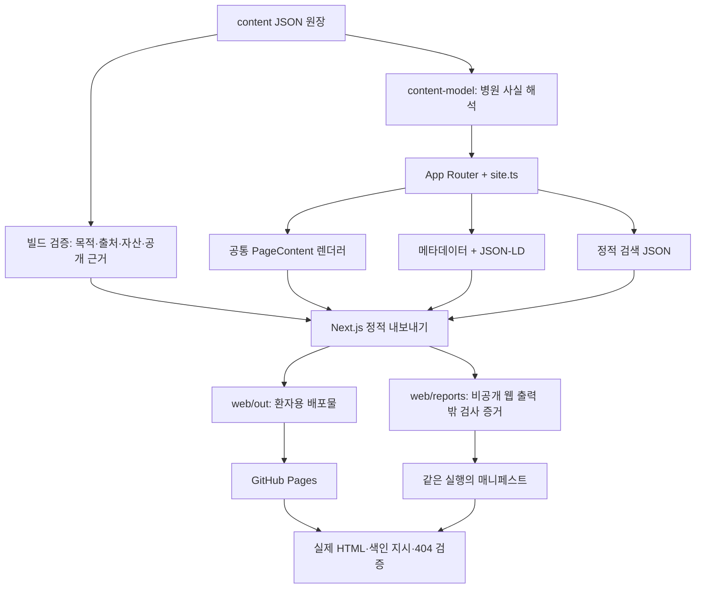

# 시스템 구성과 개발 구조

기준일: 2026-11-16. [현행 수치](inventory.json), [기능별 명세](../features/README.md).

## 1. 전체 데이터 흐름



여기서 `reports`가 웹 출력 밖에 있다는 것은 호스팅 경계를 말한다. 공개 저장소의 Actions artifact도 외부 열람 가능성을 고려하므로 비밀 자료를 넣지 않는다.

## 2. 저장소의 책임

```text
content/                 원고·병원 사실·분류·자산·출판·측정 원장
web/
  src/app/               경로·레이아웃·정적 색인 Route Handler
  src/components/        화면·상호작용
  src/lib/               데이터 해석·분류·URL·검색·구조화 데이터
  scripts/               빌드·검증·자산 가공·관측 집계
  tests/unit/            순수 로직·계약·공개 조건 회귀
  tests/e2e/             정적 사이트·브라우저·접근성 회귀
  public/                배포 가능한 정적 파일
  out/                   생성 결과, 직접 편집 금지
  reports/               생성된 검사·매니페스트, 웹 배포에서 제외
harness/                 Python 기반 재사용 검증·측정
.github/workflows/       root/project 검사와 Pages 배포
docs/                    현행 명세·설계·운영·교육
  client-requests/       의뢰자 요청서·날짜별 요청 관련 자료
plan/, assets/           원본 요청 자료·이미지 원본 등. 공개 가능 여부 별도 확인
.local/, research/       로컬 실행·조사 자료, 현재 gitignore 대상
```

루트에는 npm 패키지가 없다. 의존성 설치와 앱 명령은 `web/`에서 실행한다. 원본 자료 중 자산 검증이 읽는 파일은 `validate.mjs`·`assets.json`에서 확인하며 무조건 삭제하거나 경로를 옮기지 않는다.

## 3. 경로와 렌더링

| 진입점 | 역할 |
|---|---|
| `src/app/(ko)/page.tsx` | 홈 원고를 `PageContent`로 렌더링 |
| `src/app/(ko)/[...segments]/page.tsx` | 한국어 일반 경로를 원장에서 생성. `dynamicParams=false` |
| `src/app/[locale]/checkups/visa/page.tsx` | 비자검진의 제공된 번역 5개 생성 |
| `src/app/(ko)/layout.tsx` | 한국어 공통 헤더·푸터·인쇄·production 분석 태그 |
| `src/app/[locale]/layout.tsx` | 지원 언어 검증·해당 언어 레이아웃 |
| `src/app/global-not-found.tsx` 등 | 오류 화면. 빌드 스크립트가 최종 `404.html` 메타를 보정 |
| `src/app/search-index.json/route.ts` | `force-static` GET으로 검색 자원 생성 |

`(ko)`는 URL에 나타나지 않는 Route Group이다. `[...segments]`는 요청 시 DB 조회하는 서버가 아니라 빌드 시 확정한 경로를 만드는 데 사용한다. 정적 GET도 배포 후 실행되는 API 서버를 뜻하지 않는다. Next.js의 정적 내보내기 동작은 [공식 문서](https://nextjs.org/docs/app/guides/static-exports)와 현재 프로젝트 코드를 함께 확인한다.

## 4. 모듈 경계

| 모듈 | 입력 → 출력 | 변경 영향 |
|---|---|---|
| `content-model.mjs` | 병원 원장·플레이스홀더 → 해석한 공통 사실·원고 | 화면·검증·JSON-LD 전체 |
| `information-architecture.mjs` | 분류·페이지 → 메뉴·허브·소속·사이트맵 | 탐색·검색·구조화 목록 |
| `site.ts` | 해석 데이터 → 조회 함수·Metadata·브레드크럼 | 모든 페이지 |
| `content.tsx` | `Page` → 홈·허브·상세·특수 화면 | 여러 템플릿과 기능 |
| `search-model.mjs` | 원고·분류·별칭 → 검색 항목 | 사이트 검색·백과 검색 |
| `structured-data.mjs` | 원고·병원·의료진 → JSON-LD 그래프 | SEO·본문 일치 |
| `notice-model.mjs` | 공지·한국 날짜 → 목록·기간 상태 | 홈 공지·목록·상세 |
| `scripts/data.mjs` | 파일들 → 검증 데이터·renderer digest | 공개 근거의 유효성 |

## 5. 서버·클라이언트 구분

본문·헤더 링크·질문과 답변은 정적 HTML로 제공한다. 브라우저 상태가 필요한 검색, 모바일 메뉴 보강, 이미지 확대, 공지 필터·기간 상태, 인쇄 보조, 분석 태그에 Client Component를 사용한다. 대부분의 본문·일반 링크는 JavaScript 없이 읽을 수 있고, 검색은 전체 페이지 링크로 대체 탐색을 제공한다.

외부 서비스에는 지도·공식 채널·원문 링크와 조건부 GTM/GA 태그가 있다. 환자용 앱의 운영 DB·비밀 API 키·서버 세션은 없다. [운영자 앱 계획](../features/f16-admin-dashboard.ko.md)은 이 구조의 현재 구성요소가 아니다.

## 6. 유지보수상 제약과 개선 후보

| 관찰된 구조 | 개발 시 주의 | 확장 후보 |
|---|---|---|
| `content.tsx`에 여러 화면 분기 | 공통 수정 시 다른 템플릿도 확인 | 출력 보존 후 홈·허브·본문·특수 화면 분리 |
| Zod와 TS 타입, 문자열 템플릿 분산 | 필드 하나의 수정도 여러 지점 확인 | 콘텐츠 타입·템플릿 책임 통합 검토 |
| 허브 구성에 명시적 ID 목록 사용 | 새 원고가 자동으로 탐색에 연결되지 않을 수 있음 | 분류 계약과 누락 검사 강화 |
| 콘텐츠·렌더러와 공개 digest 결합 | CSS·공통 컴포넌트도 공개 검증에 영향 | 영향 범위와 검증 이유를 PR에 기록 |
| 정적 호스팅 | 저장·로그인·예약 처리에 백엔드 필요 | 필요가 입증된 기능만 별도 서비스 경계 검토 |
| 분석 태그의 외부 컨테이너 | 저장소 코드만으로 실제 전송을 확정 못함 | 운영 계정·네트워크 검증 유지 |

위 항목은 결함 확정이나 구현 완료 목록이 아니다. [백로그](../roadmap/backlog.ko.md)에 따라 작은 변경으로 검증한다.
