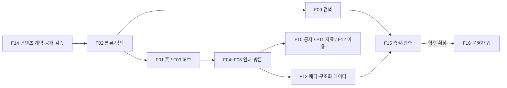

# 기능별 개발 목록

기준일: 2026-11-16. 기능은 사용자·운영 목적과 검증 가능한 결과로 나눈 개발 단위다. 현재 코드가 이 폴더 구조로 분리되어 있다는 뜻은 아니다. 특히 공통 `content.tsx`와 분류·원장은 여러 기능이 공유한다.

## 1. 기능 카탈로그

| ID | 기능·명세 | 현재 상태 | 핵심 개발 접점 |
|---|---|---|---|
| F01 | [홈·환자 목적 진입](f01-home.ko.md) | 구현 | 홈 원고·`Home`·주요 안내 |
| F02 | [공통 탐색·사이트맵](f02-navigation.ko.md) | 구현 | 헤더·메뉴·분류·목차·HTML 사이트맵 |
| F03 | [증상·질환·준비 허브](f03-directories.ko.md) | 구현 | 백과 분류·허브 목록 |
| F04 | [환자 안내·질문·출처 읽기](f04-patient-articles.ko.md) | 구현 | 본문·FAQ·관련 링크·인쇄 |
| F05 | [병원·의료진·공식 채널](f05-clinic-physicians.ko.md) | 구현 | 병원 소개·의료진·원장 |
| F06 | [진료분야·검사·지지치료](f06-care-services.ko.md) | 구현 | 진료·검사 허브·상세 |
| F07 | [검진·서류·비자 번역](f07-checkups-languages.ko.md) | 구현 | 검진 안내·번역 경로 |
| F08 | [방문·전화·지도·비용 문의](f08-visit-contact.ko.md) | 구현 | 공통 연락·시간·위치 |
| F09 | [사이트 검색·검색 개인정보](f09-search.ko.md) | 구현 | 정적 검색 JSON·랭킹·별칭 |
| F10 | [공지·기간·공식 문서](f10-notices-documents.ko.md) | 구현 | 자체 안내 6편·목록·PDF |
| F11 | [이미지·도해·확대](f11-visual-assets.ko.md) | 구현 | 자산 원장·배너·도해·dialog |
| F12 | [이용정책·사례 연결·오류 복구](f12-policies-errors.ko.md) | 구현 | 개인정보·저작권·원 사례·404 |
| F13 | [검색 발견·메타·구조화 데이터](f13-seo-discovery.ko.md) | 구현 | SEO·JSON-LD·robots·XML |
| F14 | [콘텐츠 검증·출판·배포](f14-publication-release.ko.md) | 구현 | 데이터 계약·공개 근거·CI |
| F15 | [운영 측정·AI 관측](f15-measurement.ko.md) | 제한 구현 | 조건부 태그·수동 집계, 성과 확인은 별도 |
| F16 | [운영자 대시보드](f16-admin-dashboard.ko.md) | 계획 | 현재 `admin/` 앱 없음 |

F01~F12는 주로 환자 화면·사용 흐름, F13~F15는 공통 품질·운영 기능이다. F16은 확장 후보다. 기능별 주 담당 경로는 [route-catalog.csv](../product/route-catalog.csv), 코드 수치는 [inventory.json](../architecture/inventory.json), 기계 판독 카탈로그는 [catalog.json](catalog.json)에서 확인한다.

## 2. 작업 단위와 의존성

이 그림은 이해와 변경 영향의 순서다. 이미 구현된 사이트를 이 순서로 다시 만들 필요는 없다. 기능 하나의 개선도 F14의 공개 경계와 F02·F13의 분류·발견 영향을 확인한다.

## 3. 모든 기능에 적용할 완료 조건

1. 해결할 환자·운영자의 필요와 현재 동작·변경 동작이 명확하다.
2. 범위·관련 원장·화면·코드·다른 기능의 영향을 적었다.
3. 정상·빈 결과·실패·키보드·작은 화면 중 관련 상태를 확인했다.
4. 원고와 출처·공통 사실·화면·검색·구조화 데이터가 일치한다.
5. [변경별 검사표](../development/testing.ko.md)에 맞는 검사를 통과했다.
6. 공개 근거를 만들거나 자동 갱신하지 않았으며 실제 배포 여부를 구분한다.
7. 기능 명세·작업 기록·필요한 생성 경로표를 갱신했다.

새 기능은 [기능 명세 템플릿](../templates/feature-spec.ko.md)으로 제안하고 [백로그](../roadmap/backlog.ko.md)에 연결한다. 아래 명세의 확장 후보·작업 예시는 현재 세션에서 구현한 결과가 아니다.
