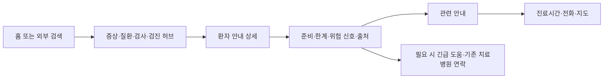

# 핵심 목표·사용자·사용 여정

기준일: 2026-11-16. 범위의 상위 기준: [환자용 콘텐츠 기준](../patient-content-policy.ko.md).

## 1. 핵심 목표

환자가 증상과 검사·진료 안내를 이해하고, 자신에게 필요한 준비와 문의·방문 방법을 찾도록 돕는다. 환자에게 보이는 같은 내용을 검색엔진과 AI도 정적 HTML·링크·구조화 데이터로 이해할 수 있게 한다.

| 목표 | 제품 행동 | 검증할 증거 |
|---|---|---|
| 필요한 안내 발견 | 증상·질환·검사·환자 목적별 탐색과 검색 | 정적 링크 도달성, 검색 시나리오 |
| 진료·검사 이해 | 목적·준비·한계·위험 신호·관련 질문 제공 | 원고와 출처의 편집 검토, HTML 대조 |
| 방문 준비 | 전화·위치·진료시간·서류 안내 | 공통 사실 일치, 전화·지도 링크 |
| 신뢰의 근거 확인 | 실제 출처, 내용 수정일, 증거가 있는 검토자만 표시 | 데이터 계약과 출처·날짜 검사 |
| 지속 가능한 운영 | 기능·데이터·검사·배포 책임 연결 | 기능 명세, PR 증거, 배포 검증 |

## 2. 주요 사용자

아래는 설계를 위한 사용자 상황이다. 실제 환자 조사나 이용 비율을 측정한 페르소나가 아니다.

| 상황 | 해결할 일 | 시작점 | 다음 행동 |
|---|---|---|---|
| 증상 때문에 걱정하는 사람 | 위험 신호와 진료에서 확인할 내용을 이해 | `/symptoms/` | 증상 안내 → 관련 검사·진료 또는 긴급 도움 |
| 검사를 예약한 사람 | 음식·복용약·준비물·귀가 지침 확인 | `/preparation/` | 해당 검사·준비약 안내 → 병원에 개인별 확인 |
| 암 치료 중인 환자·보호자 | 기존 치료병원에 연락할 상황과 지지치료 범위 확인 | `/services/cancer-support/` | 위험 신호 안내 → 담당 치료병원 연락·상담 |
| 검진·진단서가 필요한 사람 | 제출 목적·필요 서류·발급 시점 확인 | `/checkups/` | 목적별 안내 → 전화 문의 |
| 처음 방문하는 사람 | 의료진·위치·진료시간 확인 | `/about/`, `/visit/` | 전화 또는 지도 열기 |
| 한국어가 익숙하지 않은 사람 | 비자검진 안내를 읽을 언어 선택 | `/checkups/visa/` | 제공된 번역 확인 → 문의 |

## 3. 대표 사용 여정

위험 신호가 있는 안내를 예약·내원 유도로 바꾸지 않는다. 홈페이지는 개별 진단·약 중단·치료 지시를 대신하지 않는다.

## 4. 범위와 제품 원칙

- 포함: 병원·의료진·진료·검사·준비·방문·사이트 이용, 기존 원문 채널 연결.
- 현재 없는 기능: 온라인 예약 처리, 환자 로그인, 진료기록 업로드, 상담 챗봇, 진료비 결제, 관리자 CMS.
- 운영자 통계는 운영자 계정에서 확인한다. 측정을 위한 환자 팝업·배너·설정 버튼·동의 단계는 추가하지 않는다.
- 기존 홈페이지의 폐쇄·이전·일괄 리다이렉트는 전제하지 않는다.
- 기능은 환자의 필요와 운영상의 근거로 제안한다. SEO 키워드 수나 페이지 수 자체를 목표로 두지 않는다.

## 5. 성공 지표의 구분

| 구분 | 예시 | 해석 |
|---|---|---|
| 구현 품질 | 오류 없는 링크·HTML·접근성, 핵심 안내 12개의 홈 직접 링크 | 제품이 의도대로 작동하는지 |
| 운영 품질 | 근거 있는 정보 갱신, 배포 HTML 대조, 장애 복구 | 운영 절차가 실행되는지 |
| 검색 성과 | 계정에서 확인한 노출·클릭·색인 | 실제 수집 자료와 기간이 있어야 판단 |
| AI 관측 | 동일 조건 질문의 인용·오류·사람이 검토한 정확도 | 관측 표본의 결과이며 전체 AI 시장 성과가 아님 |
| 환자 행동 | 측정 가능한 범위의 전화·지도 클릭 | 실제 방문·진료·예약 완료와 구분 |

수치 목표나 전환율 기준은 기준 기간·분모·자료 출처를 확보한 후 결정한다. [측정 기능](../features/f15-measurement.ko.md)과 [확장 순서](../roadmap/backlog.ko.md)를 참고한다.
